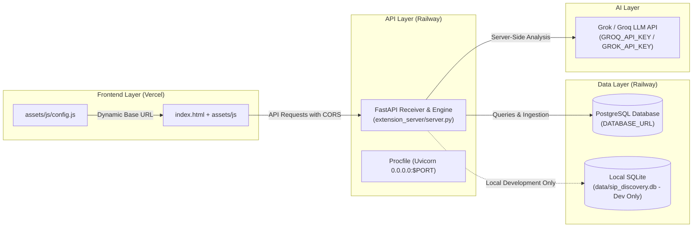

# Continuum AI — Deployment & Production Architecture Guide

> **Target Production Architecture**
> - **Frontend:** Vercel (Static Web Application)
> - **Backend / API:** Railway (FastAPI + Uvicorn)
> - **Production Database:** Railway PostgreSQL
> - **AI Provider:** Grok / Groq API (Configured securely via backend environment variables)

---

## 1. Architecture Overview



---

## 2. Environment Variables Specification

All sensitive credentials reside **strictly on the server side** in Railway's dashboard. Never expose API keys or database passwords to client-side code or public repositories.

| Variable Name | Environment | Sample / Placeholder | Description |
| :--- | :--- | :--- | :--- |
| `GROQ_API_KEY` or `GROK_API_KEY` | Backend (Railway) | `gsk_your_key_here` | Secret API key from Groq Console or xAI. |
| `GROQ_MODEL` | Backend (Railway) | `llama-3.3-70b-versatile` | Target LLM model for research synthesis. |
| `PORT` | Backend (Railway) | Automatically provided | Port assigned by Railway (e.g. `8080` or `8000`). |
| `HOST` | Backend (Railway) | `0.0.0.0` | Production host binding. |
| `FRONTEND_URL` | Backend (Railway) | `https://your-frontend.vercel.app` | Vercel production domain for strict CORS. |
| `ALLOW_VERCEL_PREVIEWS` | Backend (Railway) | `true` | Permits `https://*.vercel.app` preview URLs. |
| `EXTENSION_AUTH_TOKEN` | Backend (Railway) | `your_secret_token_here` | Auth token for Chrome extension ingestion. |
| `DATABASE_URL` | Backend (Railway) | `postgresql://...` | Connection string for Railway PostgreSQL. |

---

## 3. Step-by-Step Deployment Guide (Beginner-Friendly)

### Step 1: Push Repository to GitHub (Private)
1. Verify [`.gitignore`](file:///c:/Users/anshy/OneDrive/Desktop/Project%203/.gitignore) excludes `data/`, `.env`, and caches.
2. Initialize and push your repository to a **Private GitHub Repository**:
   ```bash
   git init
   git add .
   git commit -m "feat: deployment-ready Continuum AI engine"
   git branch -M main
   git remote add origin https://github.com/your-username/your-private-repo.git
   git push -u origin main
   ```

---

### Step 2: Deploy Backend to Railway
1. Log in to [Railway.app](https://railway.app/).
2. Click **New Project** → **Deploy from GitHub repo**.
3. Select your private `continuum-ai` repository.
4. In Railway Settings:
   - **Root Directory:** `/` (default).
   - **Build Command:** Leave empty (Railway auto-installs `requirements.txt`).
   - **Start Command:** Automatically read from `Procfile`:
     ```bash
     uvicorn extension_server.server:app --host 0.0.0.0 --port $PORT
     ```
5. In **Variables**, add:
   - `GROQ_API_KEY` = `your_actual_key`
   - `GROQ_MODEL` = `llama-3.3-70b-versatile`
   - `EXTENSION_AUTH_TOKEN` = `your_custom_secret_token`
   - `FRONTEND_URL` = `https://your-app.vercel.app` (update after Step 3)
   - `ALLOW_VERCEL_PREVIEWS` = `true`
6. Click **Generate Domain** in the Networking section. Railway will provide a public URL (e.g., `https://continuum-backend.up.railway.app`).
7. Test the health endpoint: `https://continuum-backend.up.railway.app/api/health`.

---

### Step 3: Deploy Frontend to Vercel
1. Log in to [Vercel.com](https://vercel.com/).
2. Click **Add New...** → **Project**.
3. Import your GitHub repository.
4. Configure Project Settings:
   - **Framework Preset:** `Other` (Static Site).
   - **Root Directory:** `./`
   - **Build Command:** Leave empty.
   - **Output Directory:** `./`
5. Click **Deploy**. Vercel will publish your frontend in seconds (e.g. `https://continuum-ai.vercel.app`).
6. Connect Frontend to Backend:
   - In `index.html`, the frontend uses [`assets/js/config.js`](file:///c:/Users/anshy/OneDrive/Desktop/Project%203/assets/js/config.js).
   - You can either:
     a) Inject `window.BACKEND_API_URL = "https://continuum-backend.up.railway.app";` in `<head>`
     b) Or enter the backend URL directly in the web app under **Settings / Receiver API**.
7. Return to Railway and update `FRONTEND_URL` with your Vercel URL (`https://continuum-ai.vercel.app`).

---

## 4. Railway PostgreSQL Migration Roadmap (Separate Future Step)

Do not perform this migration during initial deployment. Local SQLite remains fully operational for development.

### What is required when migrating to PostgreSQL:
1. **Driver Dependency:** Add `psycopg2-binary>=2.9.9` or `asyncpg` to `requirements.txt`.
2. **Schema Translation:**
   - SQLite `INTEGER PRIMARY KEY AUTOINCREMENT` $\rightarrow$ PostgreSQL `SERIAL PRIMARY KEY`.
   - SQLite `PRAGMA journal_mode=WAL` $\rightarrow$ Remove for PostgreSQL (PostgreSQL manages WAL natively).
   - Parameter placeholders: SQLite `?` $\rightarrow$ PostgreSQL `%s`.
   - `INSERT ... ON CONFLICT(id) DO UPDATE` is supported natively in PostgreSQL 9.5+.
3. **Data Transfer Script:**
   - Read all 570 rows from `data/sip_discovery.db` using Python `sqlite3`.
   - Batch insert into PostgreSQL using `psycopg2.extras.execute_batch()`.
   - Verify row count (`570 records`) matches exactly.
4. **Dual-Mode Adapter:**
   - In `core/database.py`, if `DATABASE_URL` is set, connect via PostgreSQL connection pool (`psycopg2.pool.SimpleConnectionPool`). If `DATABASE_URL` is not set, connect to local SQLite `data/sip_discovery.db`.
